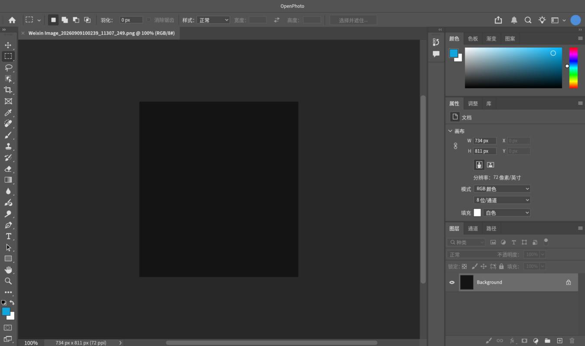
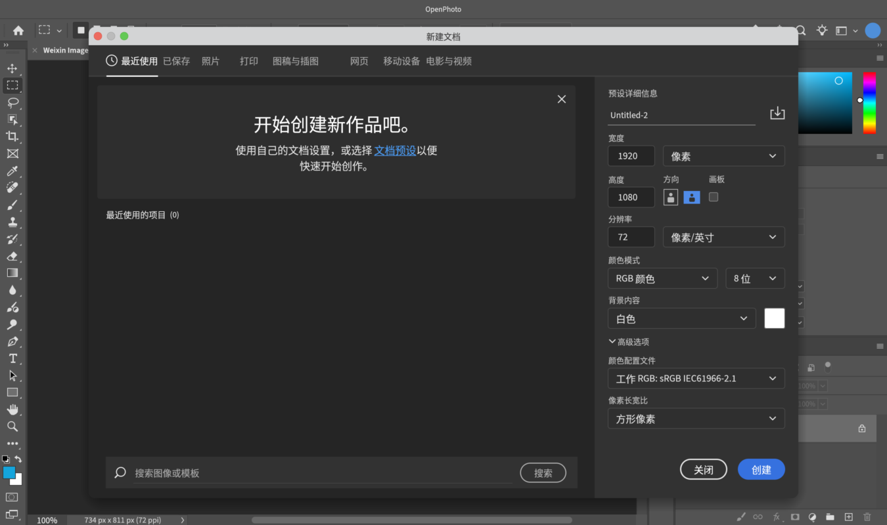
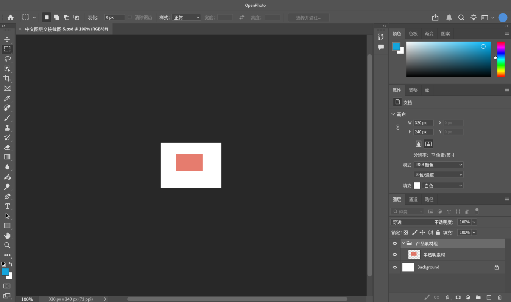

# OpenPhoto Windows 简体中文版

此分支为 `windows-zh-CN`，从已发布的 macOS 中文版提交 `082e54b` 独立开发，`main` 和 Mac 发布版本不受影响。

## Windows 使用与构建

- 面向 Windows x64，使用窗口内中文菜单和 Ctrl 系列快捷键；保留 PSD、中文字体后备和独立 MCP 服务。
- 用户预设与最近文件保存至 `%APPDATA%\\OpenPhoto`，不会把 Windows 配置写到 macOS 的 Library 路径。
- 安装 Rust 1.99.0、Visual Studio Build Tools 的“使用 C++ 的桌面开发”和 Windows SDK，然后在 PowerShell 7 运行 `./scripts/package-windows.ps1`。
- 便携包包含 `openphoto.exe`、`op-mcp.exe`、中文说明及许可证；解压整个文件夹后运行，无需安装。它未做商业代码签名，Windows 可能显示 SmartScreen 提示，请核对来源和 SHA-256。
- 自动构建结果见 [Windows Actions](https://github.com/xinping7841/OpenPhoto-zh-CN/actions/workflows/windows.yml)。已发布安装包见 [Releases](https://github.com/xinping7841/OpenPhoto-zh-CN/releases)。
- Windows 原生 CI 验证编译、严格 Clippy、CPU 图像/PSD/交互测试、中文字体和打包后 MCP。交互式 GUI、真实显卡渲染、输入法和手写板仍需在实际 Windows 电脑验收，不把 Mac 截图当作 Windows 运行证明。

以下为继承的 macOS 中文版背景与验证记录，其中 Mac 签名、通用架构和截图不代表 Windows 版测试结果。


这是 [OpenPhoto](https://github.com/yuanzhixiang/openphoto) 的非官方简体中文分支，基于上游提交 `d72a71c12a8d56cf3f49fc4c95372406b6de0222`。界面默认使用简体中文，保留原有快捷键、PSD 读写和 MCP 接口；不是 Adobe 官方产品。

- 中文化菜单、工具栏、面板、对话框和常用提示；用户文件名、图层名和工程数据不会自动翻译。
- 内置 Noto Sans CJK SC 开源字体作为中文显示后备，字体采用 SIL OFL 1.1；源码保留上游 MIT / Apache-2.0 许可证，允许商业使用。
- 项目仍处于早期开发阶段。正式交付前请用工程副本验证分层 PSD 在接收方软件中的图层、坐标、透明度和分组，勿覆盖唯一原件。
- MCP 是独立编辑进程，不代表 AI 操作会实时同步到已打开的图形窗口；MCP 协议名称保留英文。
- 本分支自行构建的应用不继承上游签名或苹果公证；没有开发者证书时仅做临时签名，请勿把它描述为已公证版本。

下载中文版请使用 [本仓库 Releases](https://github.com/xinping7841/OpenPhoto-zh-CN/releases)。下方保留上游英文介绍作为功能背景，原有截图和上游下载链接不代表中文版安装包。

## 验证范围

- 全工作区测试：672 项通过，0 失败；52 项上游或截图专用测试默认忽略。界面测试为其中的 360 项。`cargo fmt --all -- --check` 与严格 Clippy（`-D warnings`）通过。
- 额外运行中文版四张界面截图与工具选项栏截图测试，检查中文显示及布局。
- 中文 PSD 回读测试核对中文分组/图层名、层级、顺序、非零坐标、透明度和完整合成结果；这不是对所有第三方 PSD 导入器的兼容性认证。
- 安装包内应用和 MCP 均为 `arm64 + x86_64` 通用二进制；临时签名完整性与 ZIP 校验通过。
- MCP 初始化及工具发现测试通过；对话式 AI 客户端仍需自行配置和承担其服务费用。

## 中文界面预览

以下为本分支通过无窗口 UI 渲染测试实际生成的截图，并非上游英文截图：





默认新文档名和图层名（如 `Untitled`、`Layer`、`Background`）、用户自定义名称和部分技术错误详情保留英文；界面中文化不自动改写工程数据。中文文字工具的排版能力仍受上游实现限制，不能由 UI 中文字体支持推断全部中文文本编辑功能已完善。

## 构建

安装 Rust 1.99.0 和 Xcode Command Line Tools 后运行：

```sh
cargo test --workspace
cargo run --release -p openphoto
```

Mac 通用包可通过 `scripts/package-macos.sh` 构建，包含 Apple Silicon、Intel 和 `op-mcp`。简体中文界面文字与上游英文逐像素文字指标不同，布局保持原有结构。

---

<div align="center">


# OpenPhoto

**A free, open-source Photoshop alternative for Mac that works the way Photoshop does — written in Rust.**

The same layout, menus, shortcuts and dialogs as Photoshop 2026, measured point by point,<br>
with image algorithms calibrated against Photoshop's own output.

[](#license)
[](rust-toolchain.toml)
[](#getting-started)
[](#roadmap)

**[openphoto.si](https://openphoto.si/)** · [Download](https://github.com/yuanzhixiang/openphoto/releases/latest) · English · [简体中文](README.zh-CN.md)


</div>

## Why OpenPhoto

Millions of people have years of Photoshop in their hands: where every panel is, what every shortcut does, how each dialog responds. OpenPhoto aims to be a free editor where all of that carries over unchanged.

- **Pixel-faithful interface.** Windows, panels, option bars and dialogs are measured from a running Photoshop 2026 at 1:1 and compared side by side, down to field sizes, slider scales and font tracking.
- **Your muscle memory works.** Menus, item order and default shortcuts match Photoshop. Dialogs remember what Photoshop remembers and forget what it forgets.
- **Calibrated algorithms.** Adjustments and filters are fitted to Photoshop's own output using probe images: kernel by kernel, lookup table by lookup table. Fixtures captured from Photoshop are checked into the repository and tested on every change.
- **Native and fast.** Pure Rust with a GPU-composited canvas (wgpu), tiled copy-on-write pixel storage and no runtime dependencies.

<div align="center">

<br><sub>The Curves dialog: Photoshop 2026 on the left, OpenPhoto on the right.</sub>
</div>

## Features

> OpenPhoto is in early development. What is listed here works today; [the roadmap](#roadmap) covers what is still missing.

**Interface**
- Every tool's options bar, the toolbar icons, the Properties panel and the dialogs laid out at positions measured on Photoshop 2026, most within 1 pt
- Photoshop 2026's New Document dialog with its preset categories, recent and saved presets

**Documents and files**
- Opens and saves layered **PSD** files (layers, groups, blend modes, opacity and fill, masks, locks, links, color labels), checked field by field against files saved by Photoshop
- Opens PNG, JPEG, WebP, TIFF, BMP and GIF; exports PNG and JPEG
- Tabbed documents, unlimited undo with a History panel, drag and drop to open

**Layers**
- All 27 Photoshop blend modes, opacity and fill opacity, layer groups with pass-through
- Layer masks, five kinds of locks, linking, color labels, merging and flattening
- Multi-selection, drag to reorder, align and distribute

**Selection and transformation**
- Rectangular, elliptical, single-row and single-column marquees, lasso, polygonal lasso and magic wand
- Select › Modify (border, smooth, expand, contract, feather), Transform Selection
- Free Transform with skew, distort, perspective and warp; Image Size, Canvas Size, rotation, Crop with Photoshop's overlays and straightening

**Painting and retouching**
- Brush, pencil, eraser, gradient, paint bucket, clone stamp and history brush
- Blur, sharpen, dodge, burn and sponge; shapes and type; eyedropper with Photoshop's Color Picker

**Adjustments** — every dialog rebuilt after Photoshop 2026

Levels · Curves · Brightness/Contrast · Exposure · Vibrance · Hue/Saturation · Color Balance · Black & White · Photo Filter · Channel Mixer · Selective Color · Gradient Map · Threshold · Posterize · Invert · Desaturate · Equalize · Auto Tone / Contrast / Color

**Filters** — matched to Photoshop's output, most within one level

Gaussian Blur · Box Blur · Surface Blur · Motion Blur · Blur / Blur More · Unsharp Mask · Sharpen / More / Edges · Add Noise · Despeckle · Dust & Scratches · Median · Minimum · Maximum · High Pass · Offset · Custom · Mosaic · Fragment · Twirl · Pinch · Spherize · Polar Coordinates · Emboss · Find Edges · Solarize · Trace Contour · Wind

<table>
  <tr>
    <td width="50%"></td>
    <td width="50%"></td>
  </tr>
  <tr>
    <td align="center"><sub>Hue/Saturation</sub></td>
    <td align="center"><sub>Gaussian Blur, with its live preview</sub></td>
  </tr>
  <tr>
    <td colspan="2"></td>
  </tr>
  <tr>
    <td colspan="2" align="center"><sub>New Document</sub></td>
  </tr>
</table>

## Getting started

**Download** the signed and notarized app for macOS 11 or later (Apple Silicon and Intel) from [Releases](https://github.com/yuanzhixiang/openphoto/releases/latest).

To build from source (OpenPhoto is developed and tested on macOS, where it uses the native menu bar):

```bash
git clone https://github.com/yuanzhixiang/openphoto.git
cd openphoto
cargo run --release -- path/to/image.psd
```

The Rust toolchain is pinned in `rust-toolchain.toml` and installed automatically by rustup. Without a file argument, OpenPhoto opens a blank document. Files can also be dropped onto the window.

### Shortcuts

The default Photoshop shortcuts apply. A few of the most used:

| Action | Shortcut |
|---|---|
| New · Open · Save · Save As | ⌘N · ⌘O · ⌘S · ⇧⌘S |
| Undo · Redo · Toggle last state | ⌘Z · ⇧⌘Z · ⌥⌘Z |
| Free Transform | ⌘T |
| Levels · Curves · Hue/Saturation | ⌘L · ⌘M · ⌘U |
| New layer · Group · Merge down | ⇧⌘N · ⌘G · ⌘E |
| Zoom in · Zoom out · Fit · 100% | ⌘= · ⌘- · ⌘0 · ⌘1 |
| Tools | V M L W C I B S Y E G O T U H Z |
| Default colors · Swap colors | D · X |

## Architecture

OpenPhoto is a Cargo workspace. The document model knows nothing about the interface, so every editing operation can be tested without a window.

| Crate | Responsibility |
|---|---|
| [`op-core`](crates/op-core) | Document model: layer tree, 256×256 tiled copy-on-write pixels, blend modes, selections, history, adjustments, filters, transforms, painting |
| [`op-render`](crates/op-render) | wgpu canvas: zoom, mipmaps, checkerboard and pixel grid, embedded in egui through paint callbacks |
| [`op-io`](crates/op-io) | File I/O: a dependency-free PSD reader and writer, plus bitmap formats through `image` |
| [`op-color`](crates/op-color) | Color models and conversions |
| [`op-tools`](crates/op-tools) | Tool definitions and their shortcuts |
| [`op-ui`](crates/op-ui) | The egui interface: menus, option bar, toolbar, panels, dialogs and tool interaction |
| [`op-mcp`](crates/op-mcp) | MCP server: every editing operation behind keyword search, over stdio |
| [`app`](app) | The executable |

## MCP server

Agents can edit images through [`op-mcp`](crates/op-mcp), an MCP server speaking JSON-RPC 2.0 over stdio. It calls the same `op-core` / `op-io` functions as the interface, so results match the application exactly.

The server ships inside the app: once `OpenPhoto.app` is in Applications, point your MCP client at `/Applications/OpenPhoto.app/Contents/MacOS/op-mcp`. With Claude Code:

```bash
claude mcp add openphoto /Applications/OpenPhoto.app/Contents/MacOS/op-mcp
```

Other clients (Claude Desktop, Cursor and the like) take the same path in their configuration:

```json
{ "mcpServers": { "openphoto": { "command": "/Applications/OpenPhoto.app/Contents/MacOS/op-mcp" } } }
```

From a source checkout, run it with `cargo run --quiet -p op-mcp` instead.

Instead of exposing every operation as its own tool, the server exposes exactly two:

| Tool | Purpose |
|---|---|
| `search_tools` | Keyword search over ~100 operations (adjustments, filters, layers, selections, canvas, painting, history); returns matching names with their full input schemas |
| `call_tool` | Run one operation by name with arguments |

The workflow is discover-then-run: `search_tools` with `{"query": "gaussian blur"}` returns `filter_gaussian_blur` with its schema, and `call_tool` with `{"name": "filter_gaussian_blur", "arguments": {"radius": 2.0}}` applies it. Documents stay open in the server between calls: `open_image` or `new_document` first, then edit, then `export_composite` or `save_image` (`.psd` keeps the layers). `cargo test -p op-mcp` covers search scoring and an edit round-trip through the protocol.

## Testing

```bash
cargo test --workspace
```

About 350 tests guard both halves of the goal:

- **Photoshop parity.** Fixtures in [`crates/op-core/fixtures`](crates/op-core/fixtures) hold Photoshop 2026's output for a probe image under each adjustment and filter. Tests fail if a result drifts by more than the tolerance it was measured to meet, usually one level.
- **Interface behavior.** UI tests drive the real application headlessly through `egui_kittest`: open a dialog from the menu, type into fields, press Enter, and check the document and its history.

## Roadmap

Major areas that are not there yet, roughly in priority order:

- Pixel calibration of the remaining panels and dialogs
- More tools: brush presets and pressure, healing brushes, quick selection, magnetic lasso
- Remaining adjustments and filters: Shadows/Highlights, Replace Color, Smart Sharpen, Render, Distort
- Editable type and vector shapes, layer styles, adjustment and fill layers
- Channels and Paths panels, snapping, smart guides
- Color modes beyond 8-bit RGB, ICC color management
- Smart objects, actions and automation

## Contributing

Issues and pull requests are welcome. The guiding rule for any change is simple: **a running Photoshop 2026 is the reference.** If OpenPhoto looks or behaves differently from it, that is a bug. Please run `cargo fmt`, `cargo clippy --workspace --all-targets` and `cargo test --workspace` before sending a pull request, and add a test for any behavior you change.

## License

Licensed under either of

- Apache License, Version 2.0 ([LICENSE-APACHE](LICENSE-APACHE))
- MIT license ([LICENSE-MIT](LICENSE-MIT))

at your option.

Third-party assets: the interface font is [Source Sans 3](https://github.com/adobe-fonts/source-sans) (SIL Open Font License, see [`OFL.txt`](crates/op-ui/assets/fonts/OFL.txt)); icons come from [Phosphor Icons](https://phosphoricons.com) (MIT).

<sub>OpenPhoto is an independent project. It is not affiliated with, endorsed by or sponsored by Adobe Inc. Adobe and Photoshop are trademarks of Adobe Inc., used here only to describe compatibility.</sub>
